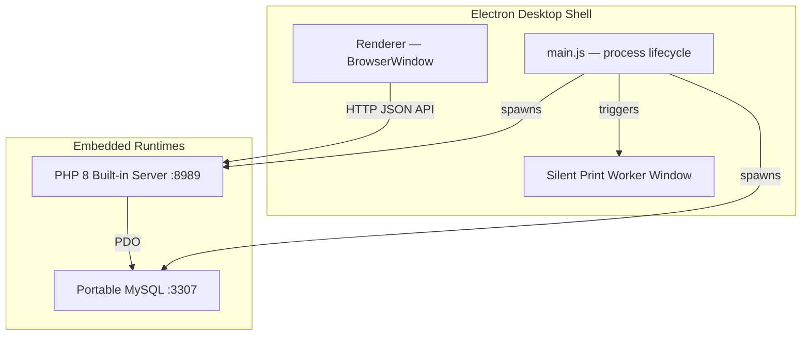

# CureRx Pro

**Digital Prescription and Clinic Management Suite**

[](https://www.electronjs.org/)
[](https://www.php.net/)
[](https://www.mysql.com/)
[](LICENSE)
[](https://github.com/HMAHD/CureRxPro/actions)

CureRx Pro is an offline-first desktop application for medical clinics, private practices, and multi-doctor healthcare centers. It combines an Electron shell, an embedded PHP API server, and a portable MySQL database to deliver patient queuing, electronic prescriptions, drug catalog management, and billing — entirely on-premise with no internet dependency.

---

## Features

**Prescription Engine**
- Searchable pharmaceutical catalog with real-time autocomplete for drugs, dosages, and instructions
- Configurable clinical templates for recurring conditions
- Longitudinal patient EMR with visit history and prescription archive

**Queue and Billing**
- Real-time token queue routing between reception and consultation rooms
- Itemized invoicing for consultations and medications, with receipt generation
- Multi-doctor support with isolated or shared queue dispatching

**Printing**
- Non-blocking background print worker for A4/A5 prescriptions and 80 mm thermal receipts
- Prints without interrupting the active consultation window

**Deployment Modes**
- Standalone: embedded portable MySQL (port `3307`) and PHP server (port `8989`), zero external dependencies
- Network client: connect multiple workstations to a primary host over LAN
- Role-based access: Complete Suite, Doctor Room, or Receptionist Counter

---

## Architecture



The frontend is plain HTML/CSS/ES-module JavaScript — no bundler. The PHP layer follows a layered architecture under `src/`: Controllers handle HTTP, Services own business logic, Repositories own data access, and thin dispatcher files in `api/` wire the two together.

---

## Repository Layout

```
cureRXPro/
├── .github/
│   ├── workflows/lint.yml          # CI: PHPStan, ESLint, PHPUnit, bun test
│   └── ISSUE_TEMPLATE/
├── api/                            # Thin dispatcher files (HTTP entry points)
├── assets/
│   ├── css/
│   └── js/
│       ├── components/             # toast.js, modal.js, autocomplete.js
│       ├── modules/                # feature modules (queue, medicines, settings …)
│       └── main.js                 # entry point, navigation wiring
├── bin/                            # Portable MySQL and PHP binaries (Windows)
├── config/
│   ├── db.php                      # PDO bootstrap
│   └── db_config.json.example
├── scripts/
│   └── migrations/                 # Numbered SQL migration files
├── src/                            # PHP application layer (PSR-4, autoloaded)
│   ├── Controllers/
│   ├── Core/                       # Validator, AuditLogger
│   ├── Repositories/
│   └── Services/
├── tests/
│   ├── Unit/                       # PHPUnit unit tests (mock PDO, Reflection)
│   ├── Integration/                # PHPUnit integration tests (SQLite in-memory)
│   ├── js/                         # bun + happy-dom component tests
│   └── bootstrap.php               # testDbPdo() SQLite fixture helper
├── tools/data-pipeline/            # Python drug classification scripts
├── views/                          # PHP view partials
├── bunfig.toml                     # bun test configuration
├── composer.json
├── main.js                         # Electron main process
├── package.json
├── phpstan.neon                    # PHPStan level-5 config
├── phpunit.xml
└── preload.js
```

---

## Quick Start

### Prerequisites

| Tool | Version | Notes |
| :--- | :--- | :--- |
| [Bun](https://bun.sh) | 1.0+ | JS runtime and package manager |
| PHP | 8.1+ | with `pdo_sqlite` and `pdo_mysql` |
| [Composer](https://getcomposer.org) | 2.x | PHP dependency manager |
| MySQL / XAMPP | any | required to **run** the app; not needed for tests |

> On macOS, [Laravel Herd](https://herd.laravel.com) is the recommended way to install PHP and Composer.

### Install

```bash
git clone https://github.com/HMAHD/CureRxPro.git
cd CureRxPro
bun install
composer install
```

### Run in development

```bash
bun run start
```

Launches the Electron app. Requires a running MySQL instance.

- **macOS:** [DBngin](https://dbngin.com) (free, one-click MySQL manager) or `brew install mysql && brew services start mysql`
- **Windows:** XAMPP, or the portable `bin/mysql` bundled in the repo

### Build the installer

```bash
bun run dist
```

Outputs the Windows installer to `dist_app/`. The `dist/` and `dist_app/` directories are gitignored — delete them freely; `bun run dist` regenerates them.

---

## Testing

Integration tests use an **in-memory SQLite database** — no MySQL instance is required to run the test suite.

### Run all tests

```bash
bun run test
```

### PHP tests (unit + integration)

```bash
vendor/bin/phpunit --testdox
```

Or by suite:

```bash
vendor/bin/phpunit --testsuite Unit
vendor/bin/phpunit --testsuite Integration
```

### JavaScript tests

```bash
bun test tests/js/
```

### Static analysis

```bash
vendor/bin/phpstan analyse --no-progress
```

### Test suite summary

| Suite | Location | Runner | Tests |
| :--- | :--- | :--- | :---: |
| PHP unit | `tests/Unit/` | PHPUnit 10 | 31 |
| PHP integration | `tests/Integration/` | PHPUnit 10 + SQLite | 19 |
| JavaScript | `tests/js/` | bun + happy-dom | 30 |
| **Total** | | | **80** |

---

## CI Pipeline

Every push to any branch runs `.github/workflows/lint.yml`:

1. **PHPStan** — level-5 static analysis across `src/`, `api/`, `config/`
2. **ESLint** — lints `main.js` and `preload.js`
3. **PHPUnit** — full test suite on PHP 8.1 with `pdo_sqlite`
4. **bun test** — all JavaScript component tests

---

## Workstation Roles

Configure the workstation role in `db_setup.php` on first launch:

| Role | Access |
| :--- | :--- |
| Complete Suite | Full access: patients, prescriptions, queue, billing, settings |
| Doctor Room | Consultation queue, patient history, prescription builder |
| Receptionist Counter | Patient intake, token generation, queue routing, checkout |

---

## Contributing

See the [project wiki](https://github.com/HMAHD/CureRxPro/wiki) for architecture details, coding conventions, branching strategy, and the pull-request checklist.

---

## License

Distributed under the **ISC License**. See [LICENSE](LICENSE).

---

Maintained by [HMAHD](https://github.com/HMAHD).
