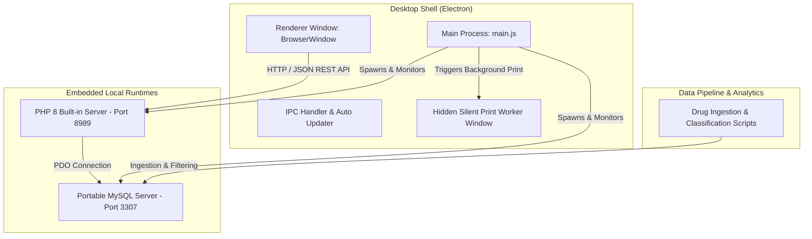

# CureRx Pro - Digital Prescription & Clinic Management Suite

[](https://www.electronjs.org/)
[](https://www.php.net/)
[](https://www.mysql.com/)
[](LICENSE)
[](https://github.com/HMAHD/CureRxPro)

CureRx Pro is an offline-first desktop application designed for medical clinics, private practices, and multi-doctor healthcare centers. Built on a hybrid architecture integrating an Electron desktop shell, an embedded local PHP engine, and a portable MySQL database server, CureRx Pro provides patient queuing, electronic prescription generation, drug catalog intelligence, and instant billing workflows.

---

## Key Capabilities

### Doctor Workstation & Prescription Engine
- **Prescription Builder**: Searchable pharmaceutical catalog with real-time autocompletion for drugs, dosages, frequencies, and administration instructions.
- **Clinical Templates**: Configurable templates for recurring medical conditions to accelerate consultation throughput.
- **Electronic Medical Records (EMR)**: Longitudinal patient visit history tracking active treatments, historical prescriptions, and clinical notes.

### Reception & Queue Management
- **Token & Queue Flow**: Real-time patient queue routing between reception counters and consultation rooms.
- **Billing Subsystem**: Itemized invoicing for consultations and prescribed medications with receipt generation.
- **Multi-Doctor Operations**: Simultaneous multi-doctor support with isolated or shared queue dispatching.

### Silent Printing Subsystem
- **Non-Blocking Execution**: Background worker window in Electron handles thermal receipt and A4/A5 prescription rendering without stealing main window focus.
- **Dual Format Support**: Print output support for standard document printers and 80mm thermal printers.

### Multi-Terminal & Hybrid Network Deployment
- **Standalone Mode**: Embedded portable MySQL (Port `3307`) and PHP server (Port `8989`) for zero-installation offline execution.
- **Network Client Mode**: Connects multiple client workstations over a Local Area Network (LAN) to a primary database host.
- **Role-Based Access Control**: Configurable workstation roles (`Complete Suite`, `Doctor Room`, `Receptionist Counter`).

---

## System Architecture



---

## Technical Specifications

| Component | Technology | Role |
| :--- | :--- | :--- |
| **Desktop Shell** | [Electron 30](https://www.electronjs.org/) | Application window lifecycle, process management, and IPC printing bridge |
| **Backend Engine** | [PHP 8](https://www.php.net/) | Embedded REST API endpoints handling queues, billing, and database transactions |
| **Database** | [MySQL / MariaDB](https://www.mysql.com/) | Relational database schema with automated schema migrations |
| **Data Pipelines** | [Python 3](https://www.python.org/) | Classification, normalization, and Excel drug master catalog parsing |
| **User Interface** | HTML5 / CSS3 / JS | Dark-themed, responsive dashboard interface |

---

## Repository Structure

```
cureRXPro/
├── .github/                    # GitHub Workflows & Templates
│   ├── ISSUE_TEMPLATE/         # Bug report & feature request issue forms
│   ├── PULL_REQUEST_TEMPLATE.md# Pull request review checklist
│   └── workflows/              # GitHub Actions CI/CD workflows (build.yml, lint.yml)
├── api/                        # RESTful API Endpoints (PHP)
│   ├── backup.php              # Database backup and restoration API
│   ├── doctors.php             # Doctor profiles management
│   ├── medicines.php           # Drug master catalog API
│   ├── patients.php            # Patient registration & records
│   ├── prescriptions.php       # Prescription builder & visit history
│   ├── queue.php               # Queue state management
│   ├── queue_billing.php       # Invoicing & payment collection
│   ├── run_migrations.php      # Automated database schema migration runner
│   └── settings.php            # Clinic information & system settings
├── assets/                     # UI Assets, Icons, and Print Stylesheets
├── bin/                        # Embedded Portable MySQL & PHP Binaries
├── config/                     # Database Connection Settings
│   ├── db.php                  # PDO database abstraction module
│   ├── db_config.json          # Active database credentials & configuration
│   └── db_config.json.example  # Configuration template file
├── db_setup.php                # Database Connection & Workstation Configuration Wizard
├── index.php                   # Main Interface & Layout Controller
├── main.js                     # Electron Main Process Entrypoint
├── preload.js                  # Preload Script for Secure IPC Context Bridge
├── scripts/                    # Build & Migration Scripts
│   ├── migrations/             # SQL Schema Migration Definitions (001, 002, 003...)
│   └── prepare-portable.js     # Portable Runtime Audit Script
├── tools/                      # Data Pipeline & Import Utilities
│   └── data-pipeline/          # Python drug classification, NLP scripts & price lists
├── LICENSE                     # ISC License File
└── package.json                # Project Manifest & Build Dependencies
```

---

## Installation & Setup

### Prerequisites

- **Node.js**: v18.x or higher
- **npm**: v9.x or higher
- **Python**: v3.8+ (optional, required for drug classification scripts)
- **Target OS**: Windows 10/11 or macOS

### Step-by-Step Installation

1. **Clone the Repository:**
   ```bash
   git clone https://github.com/HMAHD/CureRxPro.git
   cd CureRxPro
   ```

2. **Install Node Dependencies:**
   ```bash
   npm install
   ```

3. **Run Application in Development Mode:**
   ```bash
   npm start
   ```

4. **Build Production Executable:**
   ```bash
   npm run dist
   ```
   *The generated Windows installer (`.exe`) and portable builds will be placed in the `dist_app/` directory.*

---

## Workstation Access Control

Workstation access roles are configured via `db_setup.php` to scope interface elements based on user duties:

1. **Complete Suite (Single Doctor Standalone)**: Provides full operational control across patient management, consultation, prescribing, queuing, and billing.
2. **Doctor Room**: Restricts access strictly to consultation queues, medical histories, and prescription generation.
3. **Receptionist Counter**: Restricts access strictly to patient intake, token generation, queue routing, and financial checkout.

---

## License

Distributed under the **ISC License**.

---

## Maintainer

Maintained by **[CureRx HealthTech / HMAHD](https://github.com/HMAHD)**.
